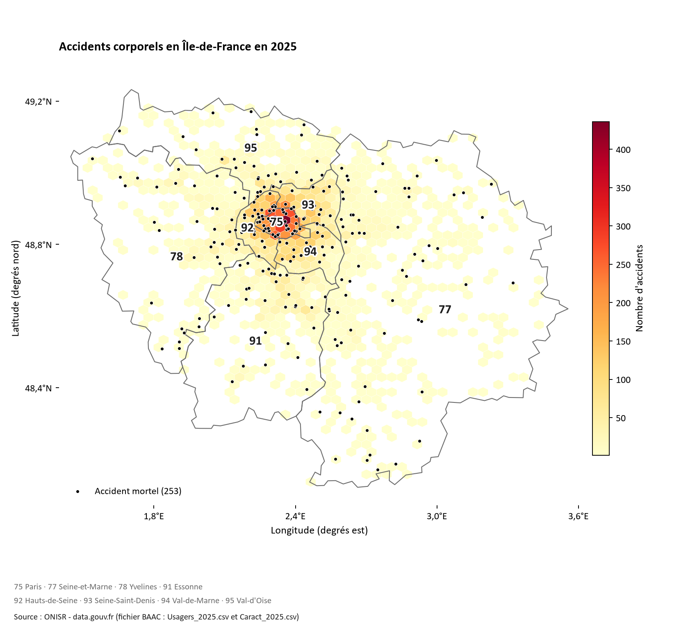
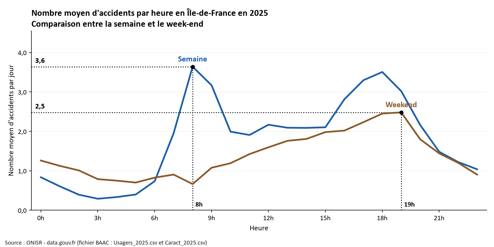

# Accidents corporels de la circulation en Île-de-France (2025)

**Objectif :** explorer la répartition géographique des accidents corporels de la circulation.
**Périmètre :** année 2025, Île-de-France (75, 77, 78, 91, 92, 93, 94, 95).
**Outils :** Python avec `pandas`, `numpy`, `matplotlib` et `geopandas`.

---

## 1. Données utilisées

- Source : [base officielle des accidents corporels](https://www.data.gouv.fr/datasets/bases-de-donnees-annuelles-des-accidents-corporels-de-la-circulation-routiere-annees-de-2005-a-2025) (ONISR, data.gouv.fr).
- `caract-2025.csv` : une ligne par accident (lieu, date, heure).
- `usagers-2025.csv` : une ligne par personne impliquée (gravité).
- Les deux fichiers sont reliés par `Num_Acc`, l'identifiant de l'accident.
- **Coordonnées géographiques :** colonnes `lat` (latitude) et `long` (longitude) de `caract`.

## 2. Nettoyage et variables

**Ce que j'ai fait :**
- Filtre sur `dep` pour garder les 8 départements d'Île-de-France.
- Virgule remplacée par un point dans `lat` et `long`, puis conversion en nombres.
- Coordonnées fausses supprimées (hors de la zone Île-de-France).
- Heure extraite en nombre entier de 0 à 23, date transformée en jour de la semaine.

**Variables utilisées :**
- `Num_Acc` : identifiant de l'accident.
- `dep` : numéro du département.
- `lat`, `long` : position de l'accident.
- `jour`, `mois`, `an` : date, pour trouver semaine ou week-end.
- `hrmn` : heure et minute, pour trouver l'heure.
- `grav` : gravité d'une personne (1 indemne, 2 tué, 3 hospitalisé, 4 blessé léger). Un accident est mortel s'il y a au moins un `grav = 2`.

Après nettoyage, on obtient 14 760 accidents, dont 253 mortels.

## 3. La carte

La carte est une carte de densité en hexagones : la région est découpée en hexagones de même taille, et chacun est coloré du jaune (peu d'accidents) au rouge (beaucoup d'accidents). Les points noirs représentent les 253 accidents mortels. Les contours des 8 départements sont dessinés avec leur numéro, et les noms correspondants sont écrits en bas de l'image. J'ai choisi des hexagones parce qu'au centre de Paris, des points individuels se cacheraient entre eux.

## 4. Seconde visualisation : accidents selon l'heure

Cette courbe montre le nombre moyen d'accidents par jour pour chaque heure de la journée, avec une courbe bleue pour lundi à vendredi et une courbe marron pour samedi et dimanche. J'ai choisi la période parce que la carte dit où ont lieu les accidents, et la courbe dit quand. J'ai choisi une courbe parce que les heures se suivent dans un ordre : la ligne montre bien la forme de la journée et fait ressortir les pics. J'ai calculé une moyenne par jour parce qu'il y a 5 jours de semaine contre 2 de week-end, donc les totaux ne seraient pas comparables. Ce graphique est utile aux collectivités, à la sécurité routière et aux forces de l'ordre pour savoir à quelles heures agir et contrôler, ainsi qu'aux automobilistes.

## 5. Règles de lisibilité appliquées

Source : [25 règles d'or de la visualisation](https://goldenviz.org/fr/readability.html).

- **Règle 7, étiquettes et graduations lisibles :** sur la courbe, je mets une graduation toutes les 3 heures (0h, 3h, 6h…) et sur la carte seulement 4 graduations par axe, avec un texte de taille 10 ou plus, pour que le lecteur ne se batte pas avec les axes.
- **Règle 8, accessibilité des couleurs :** sur la courbe, le bleu et le marron sont bien distincts même pour un lecteur daltonien, et sur la carte le dégradé du jaune au rouge se lit du plus clair au plus foncé.
- **Règle 9, étiquetage direct :** sur la carte, le numéro de chaque département est écrit directement dessus, et sur la courbe, le nom de chaque courbe est écrit à côté d'elle, donc il n'y a pas de légende à décoder.
- **Règle 10, éviter le chartjunk :** sur la carte comme sur la courbe, il n'y a pas de cadre autour du graphique, et la grille de la courbe est très légère, donc rien ne vient gêner la lecture des données.
- **Règle 13, surimpression dans les nuages de points :** sur la carte, j'utilise des hexagones à la place de points, car au centre de Paris les points se masqueraient entre eux et on ne verrait plus la densité.
- **Règle 14, précision décimale :** sur la courbe, l'axe vertical et les valeurs des pics n'ont qu'une seule décimale (par exemple 3,6), parce que plus de précision serait inutile pour une moyenne.
- **Règle 16, économie visuelle :** chaque graphique ne porte qu'un message (la densité pour la carte, l'heure pour la courbe), et la carte n'ajoute qu'une seule couche de détail, les accidents mortels.

## 6. Interprétation

Sur la carte, on voit que les accidents se concentrent au centre de la région : Paris compte 3 681 accidents, soit environ un quart du total, et avec la Seine-Saint-Denis (2 355) et les Hauts-de-Seine (2 289), ces trois départements regroupent 56 % des accidents. La grande couronne en compte beaucoup moins (860 dans le Val-d'Oise, 1 005 dans les Yvelines). On en déduit que les accidents se concentrent là où il y a le plus d'habitants et de circulation, ce qui permet de savoir dans quels départements les moyens de prévention et de contrôle sont les plus utiles. On voit aussi que les accidents mortels sont répartis sur tout le territoire, y compris loin de Paris, ce qui montre que les zones peu touchées par le nombre d'accidents ne sont pas pour autant sans danger.

Sur la courbe, on voit qu'en semaine il y a deux pics, un le matin à 8h (3,6 accidents par jour en moyenne) et un en fin d'après-midi vers 18h. On en déduit que ces pics sont liés aux trajets entre le domicile et le travail ou l'école, ce qui aide à choisir les heures où les contrôles et les rappels de prévention ont le plus d'effet. Le week-end, on voit un seul pic, en début de soirée, à 19h (2,5 accidents par jour en moyenne), et on constate qu'il y a plus d'accidents la nuit (de 0h à 6h environ) que pendant la semaine. On en déduit que le risque du week-end est surtout lié aux sorties du soir, ce qui peut aider à organiser des contrôles plus tard dans la soirée et la nuit. Au total, 15 % des accidents ont lieu entre 22h et 6h.

Ces résultats ont une limite : ce sont des nombres d'accidents et pas des taux, donc un département très peuplé a mécaniquement plus d'accidents. Pour comparer les départements de façon juste, il faudrait diviser par la population ou par le trafic. Je n'ai étudié qu'une seule année.

La carte est faite pour les personnes qui décident où agir : la préfecture et les services de sécurité routière des départements, ainsi que les mairies et les collectivités qui gèrent les routes. Elle leur sert à choisir où placer les moyens, comme les contrôles, les radars ou les aménagements de carrefours. Je l'ai choisie parce que la question est géographique et que les coordonnées GPS permettent de placer chaque accident, et j'ai pris des hexagones pour que la densité reste lisible dans les zones très touchées. La courbe est faite pour les personnes qui décident quand agir : la police et la gendarmerie pour fixer les horaires de contrôle, la sécurité routière pour programmer les campagnes de prévention, et les automobilistes pour savoir à quelles heures la route est la plus risquée. Je l'ai choisie parce que la question est celle du moment de la journée et qu'une courbe permet de comparer deux rythmes, la semaine et le week-end, sur le même graphique.
