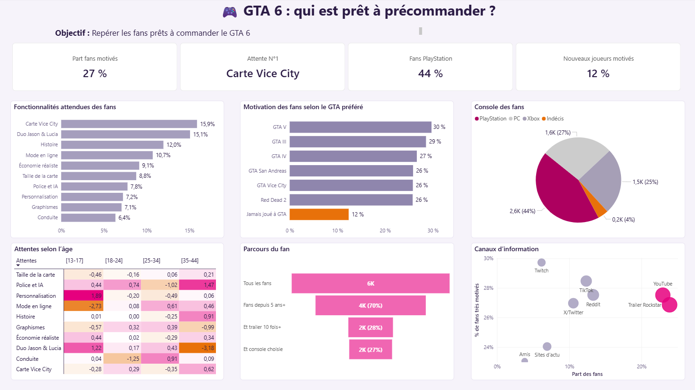

# GTA 6 : qui est prêt à précommander ?

## Partie 1 · Présentation

Ce dashboard répond à une problématique : quels fans de GTA 6 sont prêts à précommander, et quel message leur adresser ?




- **Source:** https://www.kaggle.com/datasets/uditjain13/gta-6-fan-expectations-and-hype-survey-2026
- **Public cible:** l'équipe marketing et produit. 
- **Données :** un sondage de 6 000 fans (`gta6_fan_expectations_2026`, une ligne par personne).
- **Limite majeure :** il mesure l'envie de précommande, pas l'achat réel car les données ne contiennent pas la colonne précommande.

## Partie 2 · Pour l'équipe utilisatrice

### Qu'est-ce qu'on en tire globalement du dashboard ?

- **27 %** des fans sont très motivés.
- Ils attendent surtout la **carte de Vice City** et le duo **Jason et Lucia**.
- Près d'un fan sur deux s'informe **en vidéo**.
- Quatre sur dix jouent sur **PlayStation**.
- **Point faible :** les nouveaux joueurs (jamais joué à un GTA) sont deux fois moins motivés que les autres.

### Qu'est-ce qu'un « fan très motivé » ?

Un fan très motivé est un fan qui :

- suit GTA 6 depuis au moins **5 ans** ;
- a vu le premier trailer au moins **10 fois** ;
- a déjà **choisi sa console**.


### Lecture du tableau

Chaque graphique répond à une question :

- Quelles sont les attentes ?
- Quels fans sont les plus motivés ? les moins motivés ?
- Sur quelle console jouent-ils ?
- Les attentes changent-elles selon l'âge ? On voit que tout le monde attend à peu près la même chose.
- Où perd-on du monde dans le parcours ? Surtout au trailer.
- Par où s'informent-ils ?

### Décisions

1. **Un seul message pour tous.** On met en avant Vice City et Jason et Lucia. Ces deux points pèsent 31 % des attentes et arrivent en tête à tous les âges. Pas besoin d'un message par tranche d'âge.
2. **Parler en vidéo d'abord.** Le trailer officiel et YouTube touchent 47 % des fans. Les autres canaux viennent après.
3. **Créer un contenu pour les nouveaux joueurs.** Seulement 12 % d'entre eux sont très motivés, contre 30 % chez les fans de GTA V. Il faut leur expliquer GTA 6 simplement, avec des mots et des images pour débutants.
4. **Commencer par PlayStation.** C'est la console de 44 % des fans. Le PC (27 %) et la Xbox (25 %) suivent avec le même message.


## Partie 3 · Aspect technique

### Outils

- **Power BI Desktop**, **Power Query** pour la préparation, **DAX** pour les calculs.
- Un thème JSON (`gta6_vice_city_theme_clair.json`) pour un style uniforme.


### Préparation des données

- Import du CSV dans la table `fan`, vérification des types numériques.
- Tranches d'âge créées dans `Age_categ` (13-17, 18-24, 25-34, 35-44, 45-59).


### Les mesures et colonnes calculées

#### Le fan très motivé

J'ai créé la colonne `Fan chaud`, qui vaut 1 si les trois conditions sont remplies et 0 sinon. Ça donne 1 629 fans, soit 27 % des répondants.

```dax
Fan chaud =
IF(fan[trailer1_times_watched] >= 10
   && fan[years_following_gta6] >= 5
   && fan[primary_platform] <> "Undecided", 1, 0)
```

Trois mesures servent partout : `Nb fans` compte les fans, `% du total` donne la part de chaque groupe, et `Part fans chauds` donne la part de fans très motivés. 

```dax
Nb fans = DISTINCTCOUNT(fan[respondent_id])

% du total = DIVIDE([Nb fans], CALCULATE([Nb fans], ALL(fan)))

Part fans chauds = DIVIDE(SUM(fan[Fan chaud]), [Nb fans])
```

### Les mesures des cartes

Trois mesures de plus alimentent les cartes du haut : la part de fans sur PlayStation, la part de très motivés chez les nouveaux joueurs, et la fonctionnalité la plus attendue. La carte « Part fans motivés » utilise directement `Part fans chauds`.

```dax
Part PlayStation =
DIVIDE(CALCULATE([Nb fans],
    fan[primary_platform] IN {"PlayStation 5", "PlayStation 5 Pro"}), [Nb fans])

Nouveaux joueurs chauds =
CALCULATE([Part fans chauds], fan[favorite_previous_gta] = "Never played GTA")

Fonctionnalité n°1 =
VAR t = TOPN(1, VALUES(fan[Fonctionnalité FR]), [Nb fans], DESC)
RETURN MAXX(t, fan[Fonctionnalité FR])
```


### L'entonnoir

On a créé à la main une petite table `Etapes`, avec quatre lignes et un numéro d'ordre. Une mesure `Entonnoir` calcule ensuite le nombre de fans à chaque étape :

- 6 000 fans au départ ;
- 4 189 (70 %) suivent GTA 6 depuis 5 ans ou plus ;
- 1 696 (28 %) ont en plus vu le trailer 10 fois ou plus ;
- 1 629 (27 %) ont en plus choisi leur console.

On perd surtout du monde à l'étape du trailer.

```dax
Entonnoir =
SWITCH(SELECTEDVALUE(Etapes[Ordre]),
    1, [Nb fans],
    2, CALCULATE([Nb fans], fan[years_following_gta6] >= 5),
    3, CALCULATE([Nb fans], fan[years_following_gta6] >= 5,
                            fan[trailer1_times_watched] >= 10),
    4, CALCULATE([Nb fans], fan[Fan chaud] = 1))
```


### La matrice

Pour chaque tranche d'âge, j'ai comparé la part d'une fonctionnalité avec sa part moyenne, et j'ai affiché l'écart en points.

```dax
Part dans la tranche =
DIVIDE([Nb fans], CALCULATE([Nb fans], ALLEXCEPT(fan, fan[Age_categ])))

Part globale fonctionnalité =
DIVIDE(CALCULATE([Nb fans], ALLEXCEPT(fan, fan[Fonctionnalité FR])),
       CALCULATE([Nb fans], ALL(fan)))

Écart vs moyenne (points) =
([Part dans la tranche] - [Part globale fonctionnalité]) * 100
```

J'ai retiré les 45-59 ans, car ils ne sont que 61.


